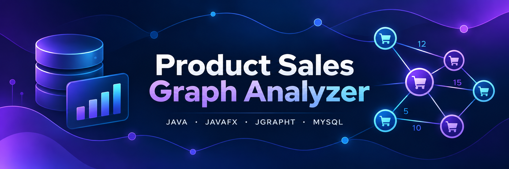

# Product Sales Graph Analyzer

A Java desktop application developed as the final examination assignment for the *Tecniche di Programmazione* (Programming Techniques) course (2022–2023) at Politecnico di Torino.

The application analyzes product sales data stored in a MySQL database and builds weighted, undirected graphs to explore relationships between products belonging to the same brand.

Users can select a year and a brand, examine the resulting graph, identify the strongest connections between products, and search for a path that satisfies specific constraints on edge weights.

## Features

- **Graph construction:** Select a year and a product brand to generate a weighted, undirected graph from sales data.
- **Product relationships:** Each vertex represents a product. Two products are connected if they were sold by the same retailer on the same day during the selected year.
- **Weighted edges:** Each edge weight represents the number of distinct retailers that sold both products under those conditions.
- **Graph statistics:** Display the total number of vertices and edges.
- **Strongest connections:** Identify the three edges with the highest weights and the products appearing more than once among them.
- **Path search:** Starting from a selected product, find a longest simple path whose edge weights are non-decreasing.

## Technologies

- **Java 17** — Application logic and graph algorithms.
- **JavaFX** — Desktop graphical user interface.
- **JGraphT** — Weighted graph representation and management.
- **MySQL** — Storage and querying of product sales data.
- **JDBC** — Database connectivity.
- **Maven** — Dependency management and project build.

## Getting Started

### Prerequisites

Before running the application, make sure the following software is installed:

- **Java Development Kit (JDK) 17**
- **Apache Maven**
- **MySQL Server**

The application requires a running MySQL database containing the sales data provided with the project.

### Database Setup

1. Start your MySQL server.
2. Create a database named `go_sales`.
3. Import the SQL script provided in the `database/GOsales.sql` file into the `go_sales` database.
4. Configure the database connection in `src/main/java/it/polito/tdp/gosales/dao/DBConnect.java` using your local MySQL credentials.

By default, the application connects to a local MySQL database named `go_sales` using the `root` user with an empty password, as commonly configured in local XAMPP environments. If your MySQL configuration differs, update the connection settings in `DBConnect.java` accordingly.

This configuration is intended for local development and educational use only.

The SQL script contains the database structure and the sales data required by the application.

### Running the Application

1. Clone the repository or download its source code.
2. Open a terminal in the project's root directory, where `pom.xml` is located.
3. Make sure the MySQL server is running and the database connection is configured.
4. Run the application using Maven:

   ```bash
   mvn javafx:run
   ```

The JavaFX desktop interface will open, allowing you to select a year and a brand, generate the corresponding graph, and explore product relationships and paths.
